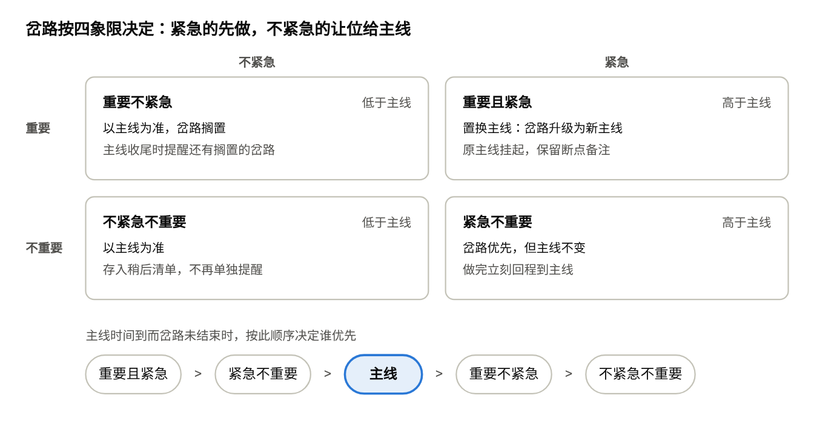
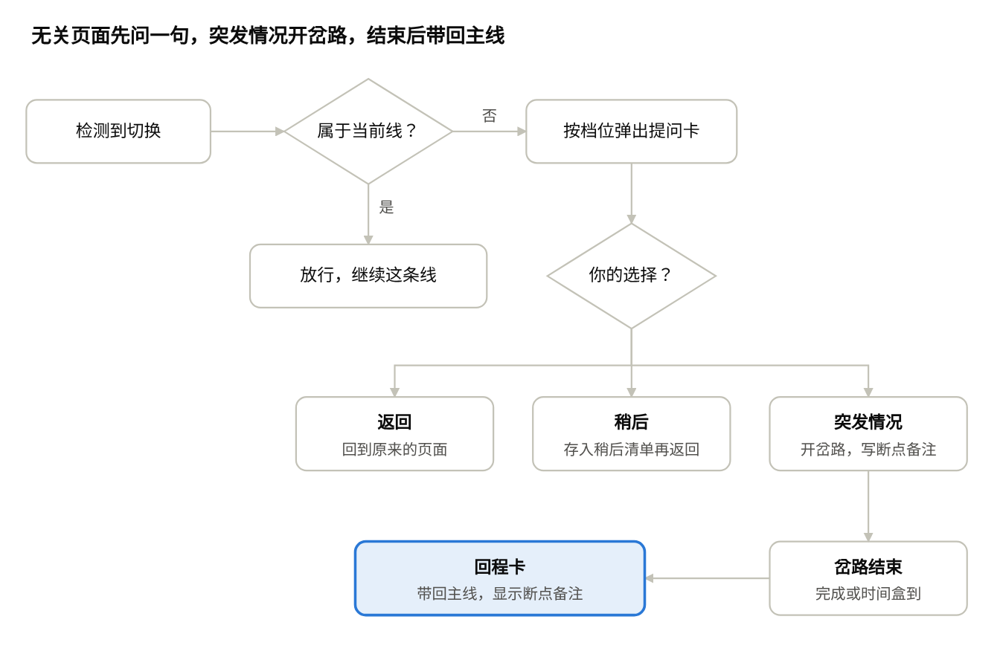
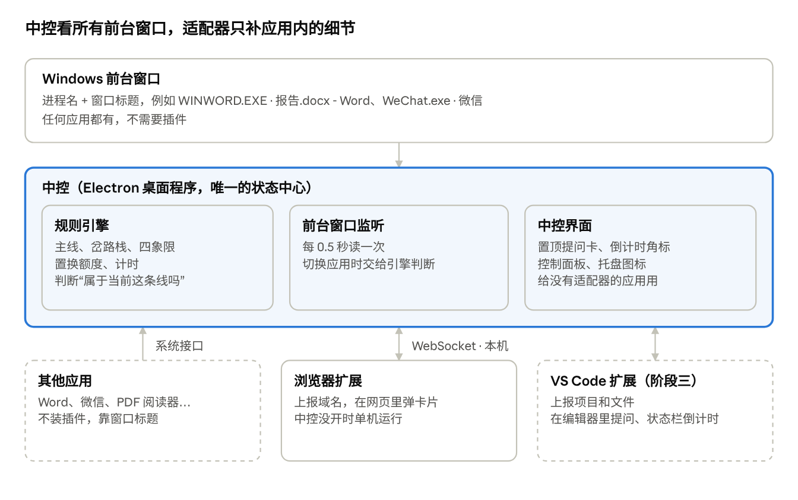

# 专注守门人：一事一毕的注意力助手

产品设计文档 · 2026-10-20 起草，2026-10-26 更新 · Linx

> 本文件从 Claude 文档导出；在线版本可以编辑和评论，此处为存档。

## 背景与问题

注意力很少是自己走丢的，多数时候是被突发情况带走的。一条典型的岔路：

写报告 → 网络断了 → 打开路由器后台 → 搜索报错代码 → 论坛侧栏一条热帖 → 半小时后忘了自己在写报告。

每一步单独看都合理。问题在于处理突发情况时，没有人记着：**我是从哪件事里出来的？出来做什么？什么时候回去？**

现有工具都守不住这条岔路：屏蔽类工具挡不住“修网络”这种正当的离开；番茄钟只计时，不知道你已经离开了主线；任务清单管一天做什么，不管这一件事怎么做完。

## 产品目标与非目标

一句话：**守住当前这一件事，让它在限定时间内一事一毕；突发情况可以去处理，但处理完要回来。**

目标：

1. 开工时只写一件事和它的时间盒。
2. 突发情况出现时，把它登记为“岔路”，给它一个小时间盒，并记下主线停在哪里。
3. 在网页或屏幕之间切换时问一句：这一步属于当前这件事吗？
4. 岔路解决或超时后，把人带回主线，并显示离开前的断点备注。
5. 时间到时收尾：完成、延长一次，或把剩下的拆成下一件事。

非目标：

- 不做全天任务规划、多任务清单、优先级排序。
- 不做周报、习惯统计等长期时间管理分析。
- 不屏蔽网站，只在切换时提问。
- 不做多人协作或他人监督。

## 典型突发情况

助手不替用户判断突发情况该不该处理，只负责给它划一个边界：做什么、多久、做完回哪。

| 突发情况 | 正当的岔路 | 常见的跑偏点 | 助手的做法 |
| --- | --- | --- | --- |
| 网络断了 | 重启路由器、查运营商公告 | 搜报错时点进论坛热帖、新闻 | 检测到断网，问是否开岔路“修网络 · 10 分钟” |
| 程序报错、环境出问题 | 查文档、Stack Overflow | 相关推荐、技术八卦 | 岔路“修环境 · 20 分钟”，超时问要不要换方案 |
| 缺一份资料 | 去网盘、邮箱、课程网站找 | 邮箱里其他未读邮件 | 岔路“找资料 · 5 分钟”，进邮箱时提醒只找这一份 |
| 收到消息 | 回复必要的那一条 | 顺手刷群聊、朋友圈 | 问“现在必须回吗？”，可存入稍后清单 |
| 设备没电、外设断开 | 换电源、重新连接 | 拿起手机就刷 | 手机端显示主线和剩余时间 |

## 核心概念

整个产品只有一条**主线**、若干**岔路**和一个**回程栈**。

| 概念 | 定义 | 示例 |
| --- | --- | --- |
| 主线 | 本次唯一要做完的事，一句话描述 | “写完报告第 3 节” |
| 时间盒 | 主线的限定时长 | 50 分钟 |
| 岔路 | 打断主线的突发情况，有自己的小时间盒 | “修网络 · 10 分钟” |
| 回程栈 | 岔路可以嵌套，按后进先出逐层带回 | 主线 → 修网络 → 查报错码 |
| 断点备注 | 离开主线时写下的一句“做到哪了” | “写到 3.2 第二段，下一句讲置信区间” |
| 偏离 | 打开的页面既不属于主线，也不属于当前岔路 | 修网络时打开视频网站 |

## 功能设计

五个模块对应一件事的生命周期：开一件事、登记岔路、切换提问、回程、收尾。

### 1. 开一件事

- 只填一句话 + 时间盒（25 / 50 / 90 分钟或自定），选提醒档位。
- 当前主线没结束时不能开第二条，只能先收尾或放弃。

### 2. 登记岔路

- 快捷键（如 `Alt+B`）或点击“我被打断了”：选原因（网络 / 报错 / 找资料 / 消息 / 其他），再回答两个问题定位四象限（见下一节）。
- 用户自己填岔路要多久，默认 5 分钟。
- 登记时提示写一句断点备注，3 秒内不写自动跳过。
- 自动识别部分突发情况：浏览器检测到断网（`navigator.onLine` 与 `offline` 事件）时，主动问是否开“修网络”岔路。
- 切换提问里选“这是突发情况”也会直接进入登记。
- 岔路里还能再开一层，最多 3 层；第 3 层时提醒“已经离主线三步远了”。

### 3. 切换提问

触发点：切换到另一个应用（中控检测前台窗口）；在浏览器里新开或切换标签页、跳转到新域名（浏览器适配器上报）。问题以当前所在的那条线为准：

1. **这一步属于「修网络」吗？**（显示当前线的名称）
2. 属于 → 放行；不属于 → 选择：这是突发情况 / 记到稍后 / 返回。

### 4. 回程

- 岔路标记完成或时间盒到时，弹出回程卡：“回到主线：写完报告第 3 节”，并显示断点备注。
- 一键切回离开主线时的那个标签页。
- 岔路超时未完成：延长 5 分钟（仅一次）/ 搁置岔路先回主线 / 把岔路升级为下一件事。

### 5. 收尾

- 主线时间盒到时，若没有进行中的岔路：完成 / 延长一次（最多原时长的一半）/ 把剩下的部分写成下一件事。
- 若还有进行中的岔路：按岔路的象限决定谁优先（见下一节）。
- 列出被搁置的“重要不紧急”岔路，问要不要作为下一件事。
- 显示本次小结：用时、岔路数、偏离次数、稍后清单。只看这一件事，不做长期统计。

小结把每次“不属于当前线”的切换分成四类，不再用一个笼统的“偏离”数字：

| 类别 | 来源 |
| --- | --- |
| 必要切换 | 点了“属于”；或没回答、停留不到 2 分钟（预判） |
| 突发情况 | 登记成了岔路 |
| 拦下的分心 | 点了“返回”或“记到稍后” |
| 分心 | 没回答、停留超过 2 分钟（预判） |

“没回答”指 0 观察档和轻提示卡自动消失。小结列出这些切换供一键改正；改为“必要”时询问是否记住，记住后下次做同名的事自动放行该应用或网站。

## 岔路四象限

每条岔路登记时都要放进一个象限；象限决定它现在做还是让位，以及主线时间到时谁优先。

登记时用两个问题定位象限：**不马上处理会出问题吗？**（紧急）**这件事本身重要吗？**（重要）

- **登记时**：两个紧急象限立即开始岔路；两个不紧急象限默认不开始，直接搁置或存入稍后，用户仍可选“现在就做”。
- **主线时间到、岔路未结束时**：重要且紧急 → 岔路置换为新主线，原主线挂起；紧急不重要 → 继续岔路，做完回主线，主线不变；重要不紧急 → 主线优先，岔路搁置，收尾时提醒；不紧急不重要 → 主线优先，岔路存入稍后清单。
- **置换后**：新主线完成时，回程卡提示恢复被挂起的原主线。
- **置换次数限制**：任意 2 小时内最多置换一次。额度用完后再选“重要且紧急”，按“紧急不重要”处理：岔路优先，但主线不变；卡片上注明下次可置换的时间。

## 提醒强度分档（用户自选）

四个档位，每次开一件事时选择。档位越高，离开当前线越难。

| 档位 | 适合场景 | 属于当前线的页面 | 不属于当前线的页面 | 岔路超时 | 跳过方式 |
| --- | --- | --- | --- | --- | --- |
| 0 观察 | 先了解自己怎么跑偏 | 不提示 | 不提示，只记录 | 不提示 | — |
| 1 轻提示 | 日常工作 | 不提示 | 角落小卡片，3 秒后消失 | 角落提醒回主线 | 点击即关 |
| 2 坚定 | 写作、编程等深度工作 | 不提示 | 全屏半透明卡片，必须选一项 | 弹出回程卡，必须选一项 | 选一项 |
| 3 严格 | 截止日前 | 不提示 | 默认返回；输入“我确定现在要看”并等 30 秒才放行 | 自动切回主线标签页 | 输入确认句 + 等待 |

补充规则：

- **怎么算“属于当前线”**：用户在本条线里放行过的域名自动放行；岔路按原因预设相关域名（修网络：路由器管理地址、运营商网站、搜索引擎）。
- **搜索结果页放行，但从结果页点进的新域名再问一次**——这是修问题时最常跑偏的地方。
- **紧急出口**：任何档位都可以暂停 10 分钟，每件事最多一次。

## 关键交互流程

页面不属于当前这条线时才提问；选“突发情况”会开一条岔路，岔路结束后回程卡把人带回主线。

在岔路里再切换时，同样的检查以岔路为准；岔路可以嵌套，回程按后进先出逐层返回，最后回到主线。

## 架构：中控 + 适配器

中控是本机常驻的桌面程序，是唯一的状态中心：主线、岔路栈、四象限、置换额度和计时都在这里。它直接读取系统前台窗口，因此不装插件的应用（微信、PDF 阅读器）也能管到；只有需要更细信息或要在应用内弹卡片的地方才做适配器。

| 组件 | 负责什么 | 技术选型 | 关键接口 |
| --- | --- | --- | --- |
| 中控 | 状态机、计时、前台窗口检测、置顶提问卡、托盘图标、控制面板 | Electron（Node.js），以后可迁移 Tauri | 前台窗口：npm `get-windows` 每 0.5 秒轮询；Windows 底层为 `GetForegroundWindow` |
| 中控通信 | 适配器上报事件，中控下发卡片指令和状态 | 本机 WebSocket | `ws://127.0.0.1:47321`，只监听本机 |
| 浏览器适配器 | 上报网址与域名，在网页里显示卡片；中控未运行时退回单机模式 | Chrome 扩展（Manifest V3） | `chrome.tabs.onActivated`、`chrome.tabs.onUpdated`、Service Worker 内的 WebSocket |
| VS Code 适配器（阶段三） | 上报项目和文件，在 VS Code 里提问、状态栏倒计时 | VS Code 扩展 | `vscode.window.onDidChangeActiveTextEditor`、`onDidChangeWindowState` |
| Word 等 Office 应用 | 不做插件，靠窗口标题判断（如 `报告.docx - Word`） | — | Office 插件需 HTTPS 加载，且拿不到切入切出事件，收益小 |
| 手机（阶段四） | 显示主线、岔路和剩余时间 | PWA | 订阅中控同步出的当前状态 |
| macOS（阶段五） | 同一中控 | Electron | 读取前台窗口需用户授予辅助功能和屏幕录制权限 |

## 数据模型

五张表，围绕“一件事”组织；岔路用 `parent_id` 串成回程栈。

| 表 | 关键字段 | 说明 |
| --- | --- | --- |
| `focus_items` | id, title, timebox\_min, level, started\_at, ended\_at, status | 主线，同一时刻只有一条；status 为 doing / done / extended / split |
| `detours` | id, focus\_id, parent\_id, reason, quadrant, timebox\_min, breakpoint\_note, return\_tab\_id, started\_at, ended\_at, outcome | 岔路；outcome 为 done / parked / promoted |
| `switch_events` | id, focus\_id, detour\_id, from\_domain, to\_domain, decision, off\_track | 切换记录；decision 为 pass / later / back / detour |
| `later_items` | id, focus\_id, text, url, created\_at | 稍后清单 |
| `site_rules` | domain, scope（本条线 / 某类岔路）, allowed | 放行规则 |

只记域名，不记网页标题和正文。

## 隐私与伦理

浏览记录是高度敏感的数据，产品的信任建立在“只为用户本人服务”上。

- **本地优先**：切换记录默认只存本机；开启同步后才上传，且只传域名、意图和时长。
- **不读网页正文**，不截图，**端到端加密**：同步数据用用户密钥加密，服务器看不到明文。
- **窗口标题**：中控读到的前台窗口标题只在内存里用于判断，记录里只留进程名。
- 不记录键盘输入。
- **一键导出与删除**全部数据。
- **无痕/隐私窗口**默认不记录、不提示。
- 档位 3 的拦截是用户自愿给自己设的，产品不提供“他人远程锁定”功能，避免被用于监控。

## 成功指标

核心指标是**一事一毕率**：主线在时间盒内（含一次延长）完成的比例。具体目标值等 MVP 收集到基线后再定。

| 指标 | 定义 | 衡量什么 |
| --- | --- | --- |
| 一事一毕率 | 按时完成的主线 ÷ 开启的主线 | 产品是否有效 |
| 回程率 | 岔路结束后回到主线（而不是转去别处）的比例 | 回程卡是否起作用 |
| 岔路超时率 | 超出自己时间盒的岔路比例 | 突发情况是否被控制在边界内 |
| 偏离次数 | 每件事中“分心”类切换的次数（不含必要切换、突发情况和拦下的分心） | 切换提问是否拦住了跑偏 |
| 打扰感 | 每件事结束时一键评价：提醒太多 / 刚好 / 太少 | 档位是否合适 |

## MVP 范围与路线图

先用浏览器扩展验证规则，再把规则搬进中控，覆盖所有桌面应用。

1. **阶段一 · 浏览器扩展（已完成初版）**：开一件事、切换提问、岔路登记与回程栈、断网自动提示、回程卡、收尾、四档强度、四象限与置换限制。
2. **阶段二 · 中控（进行中）**：Electron 中控接管状态；前台窗口检测、置顶提问卡、倒计时角标、托盘；浏览器扩展连接中控，中控没开时单机运行。
   - 进入下一阶段的条件：自己和 5–10 位同学连续用 2 周，一事一毕率和回程率有提升。
3. **阶段三 · VS Code 扩展**：上报项目和文件，在编辑器内提问，状态栏倒计时。
4. **阶段四 · 手机伴随**：手机网页显示主线、岔路和剩余时间，可一键登记岔路。
5. **阶段五 · macOS**：同一中控适配 macOS 的前台窗口接口和权限。

## 风险与待决问题

| 风险 | 影响 | 应对 |
| --- | --- | --- |
| 提醒疲劳：问太多，用户直接卸载 | 高 | 属于当前线的页面自动放行；默认档位 1 |
| 用户绕过：拿起手机或用别的浏览器 | 中 | 阶段二由中控检测所有桌面应用的切换；手机在阶段四 |
| 相关性判断不准：修问题时搜索结果页既相关又容易跑偏 | 高 | 结果页放行，从结果页点进的新域名再问一次 |
| 用户懒得登记岔路 | 高 | 切换提问一键转岔路；断网自动提示；快捷键一步完成 |
| 岔路越走越深 | 中 | 最多 3 层，第 3 层时提醒离主线的距离 |
| 窗口标题含敏感信息（文件名、聊天对象） | 高 | 只在本机判断；规则按进程名匹配；不保存完整标题 |
| 中控没有运行 | 中 | 浏览器扩展退回单机模式；中控开机自启 |
| 全屏应用上置顶窗口被盖住或被系统拦下 | 中 | 退回系统通知 |

待决问题：

- [ ] 置换主线后，被挂起的原主线剩余时间是保留还是重新填写？
- [ ] 断网之外，还有哪些突发情况值得自动识别（如 IDE 报错、电量低）？
